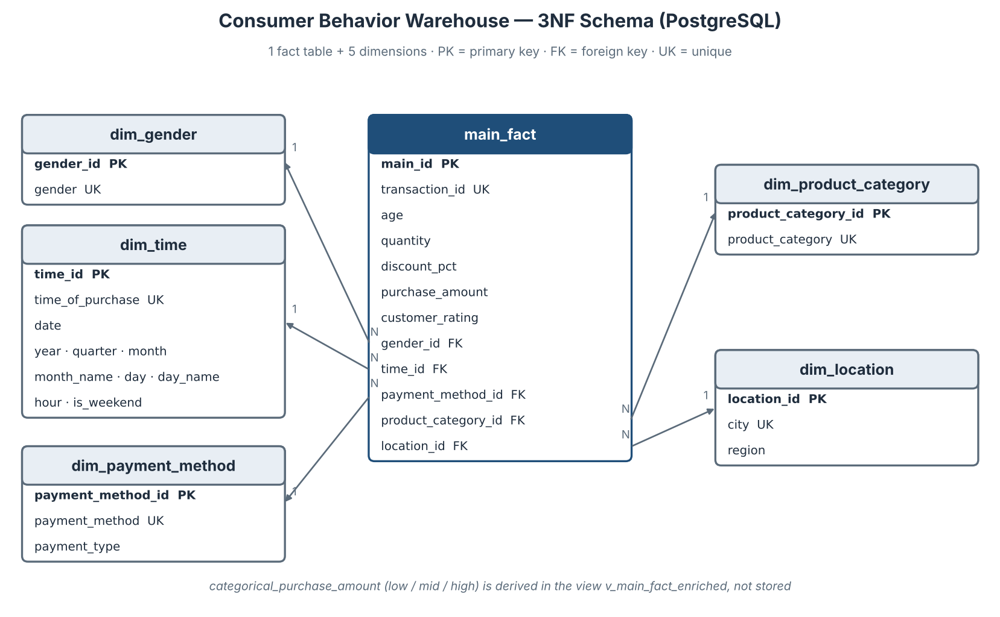

# **Marketing Data Pipeline for Consumer Behavior (Pandas → PostgreSQL, 3NF)**

**Client:** specialty coffee & bakery chain in Vietnam — 37 outlets across 7 cities (client name withheld)
**Role:** freelance data engineer / analyst · **Data period:** July 2024 – June 2025

## Overview
The client's marketing team worked from a monthly point-of-sale (POS) export merged from several store systems. The file was too messy to trust: prices typed in six different currency formats, four timestamp formats (including day-first dates), city and payment labels mixed in English and Vietnamese, invalid ages, duplicated transactions, ×10 typos and refunds mixed in with sales. Every KPI (revenue, AOV, payment mix) came out differently depending on who calculated it.

This project turns that export (**110,214 lines, 20 columns**) into an analytics-ready **3NF** PostgreSQL warehouse: profile → clean and standardize (with a cleaning log) → normalize into **one fact table and five dimensions** → export CSVs → generate a ready-to-run SQL script → validate with test queries in both Pandas and PostgreSQL.

**Result:** 106,719 clean purchase lines (96.8% of the raw file) in a schema with primary/foreign keys, CHECK constraints, indexes and an analytics view — verified by a lossless-join test and identical query results in Pandas and PostgreSQL 16.

## Repository structure
```
├── Notebook.ipynb                     # end-to-end pipeline (EDA, cleaning, 3NF, export, SQL generator, tests)
├── Consumer_Behavior_SQL.sql          # DDL + \copy load + view + test queries (generated by the notebook)
├── requirements.txt
├── data/raw/pos_transactions_raw.csv  # raw POS export (input)
└── consumer_behavior/
    ├── tables/                        # 6 normalized tables as CSV (output)
    └── query_outputs/                 # results of the two test queries (output)
```

## Data-quality issues handled
| Issue in the raw export | How it was fixed |
|---|---|
| 1,480 duplicate lines (exact copies + IDs differing only by case/whitespace) | Drop exact duplicates, normalize ID, drop duplicates on ID |
| 4 timestamp formats, day-first dates, text like `#VALUE!`, typo years (2042) | Parse with explicit formats only; keep the Jul 2024 – Jun 2025 window |
| Currency as `45,000` · `45.000 đ` · `₫45,000` · `45k` · `VND 45,000.00` | One VND parser handling comma vs dot thousands and the `k` suffix |
| Gender in 21 variants (`F`, `Nữ`, `Nam`, `MALE`, `-`, …) | Female / Male / Other / Unspecified (rows kept) |
| City in 29 variants (`TP.HCM`, `Sai Gon`, `Hà Nội`, `HN`, …), some blank | Diacritic-free matching; blanks recovered from the store-code prefix |
| Payment (23 variants) and category (29 variants) labels, some blank | Canonical mapping; blank categories recovered from the item name |
| Invalid ages (0, -5, 199, `unknown`, `29 yrs`) | Extract number, valid range 15–80, impute with category median |
| Blank/zero amounts, ×10 typos, refunds | Recompute from qty × price × (1 − discount); typos ÷10; refunds removed |
| Ratings as `4/5`, `4 stars`, out of range | Keep 1–5; unrated stays NULL (not 0) |

## Database schema (3NF)


- `region` depends on `city` and `payment_type` on `payment_method` — both candidate keys of their dimension, so the design stays in 3NF.
- `categorical_purchase_amount` (low < 60k · mid 60k–<150k · high ≥ 150k VND) is derived from `purchase_amount`, so it is **not stored** in the fact table; it is exposed through the view `v_main_fact_enriched`.

| Table | Rows |
|---|---|
| `main_fact` | 106,719 |
| `dim_time` | 103,185 |
| `dim_gender` | 4 |
| `dim_payment_method` | 7 |
| `dim_product_category` | 7 |
| `dim_location` | 7 |

## Quick start
**A) Run the notebook**
```bash
pip install -r requirements.txt
jupyter notebook Notebook.ipynb      # Run All
```
The notebook writes the six CSVs to `consumer_behavior/tables/`, the query results to `consumer_behavior/query_outputs/`, and regenerates `Consumer_Behavior_SQL.sql`.

**B) Build the database (PostgreSQL 13+)**
```bash
# from the repository root
psql -U postgres -f Consumer_Behavior_SQL.sql
```
The script creates the database `consumer_behavior_dw`, the tables with constraints and indexes, loads the CSVs with `\copy` (relative paths — no need to move files to `/tmp/`), creates the view and runs the test queries.

## Test query results (PostgreSQL = Pandas)
**a) Total purchase amount by gender, age ≤ 30 (VND)**

| gender | total_purchase_amount | transactions |
|---|---:|---:|
| Female | 2,972,532,500 | 38,767 |
| Male | 2,423,224,000 | 31,571 |
| Unspecified | 171,509,000 | 2,218 |
| Other | 103,204,000 | 1,380 |

**b) Purchase amount by product category (VND)**

| product_category | avg | min | max | transactions |
|---|---:|---:|---:|---:|
| Packaged Beans | 242,851 | 127,000 | 640,000 | 3,983 |
| Merchandise | 241,605 | 79,000 | 900,000 | 4,000 |
| Blended Ice | 87,234 | 47,000 | 414,000 | 13,340 |
| Tea | 70,739 | 36,000 | 354,000 | 22,026 |
| Sandwich & Snacks | 62,996 | 28,000 | 354,000 | 8,853 |
| Coffee | 60,524 | 23,000 | 330,000 | 37,999 |
| Bakery | 46,926 | 20,000 | 270,000 | 16,518 |

## Key findings
- **VND 8.29 billion** in sales over 12 months; average line value VND 77,700 (median 52,000); 62% of lines are under VND 60,000.
- **Young, urban customer base:** median age 28, 69% aged 30 or under; Ho Chi Minh City + Hanoi = 72% of revenue.
- **Dayparts:** coffee is 44% of morning lines; tea and blended ice reach 44% in the afternoon.
- **Tet gifting:** beans and merchandise rise from 21% to 46% of revenue in the two weeks before Tet; January 2025 was the strongest month.
- **Cashless shift:** cash fell from 18.2% to 13.6% of lines (H2 2024 → H1 2025); MoMo leads at 33.5%.

Full analysis and recommendations are in section VII of the notebook.

## Tech stack
Python 3.10+ (Pandas, NumPy) · PostgreSQL 13+ (`psql`) · Jupyter
